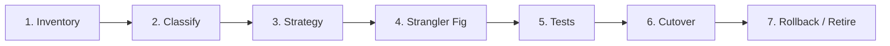
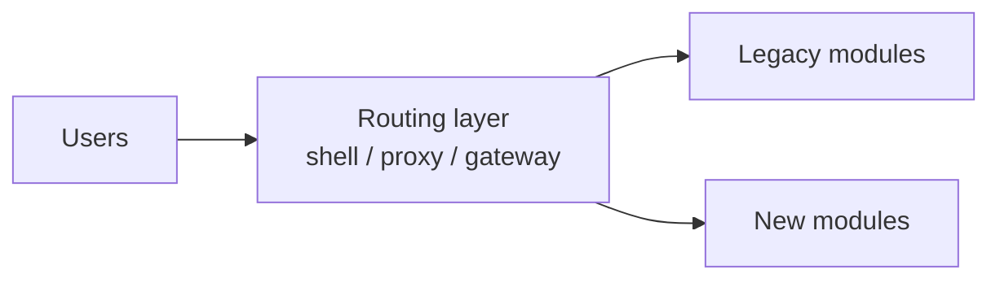

# `playbook/README.md`

# Legacy Migration Playbook

A generic, incremental method to move a legacy application to a modern stack without stopping the business. It is based on public practices (Strangler Fig, characterization tests, canary release, 6 Rs of migration) and uses fictional examples only.

**Rule of the playbook:** migrate in small, reversible steps. Every wave has an owner, an exit criterion and a way back.

---

## 1. Inventory: know what you have

**Collect, per component:**
- Applications, modules and owners
- Runtime, framework and library versions
- Databases, scheduled jobs, file shares
- Integrations and contracts
- Users, volume and peak periods

**Sources:** repositories and build files, dependency and vulnerability scans, logs and monitoring data, interviews with the people who run the system.

**Output:** one register, one row per component.

## 2. Classify: value vs. health

| Business value | Technical health | Typical decision |
| --- | --- | --- |
| High | Poor | **Modernize first** (refactor or rewrite) |
| High | Good | Keep and maintain |
| Low | Poor | Retire or replace with a product |
| Low | Good | Leave alone, monitor |

Also score: security exposure, end of support, change frequency, team knowledge and dependencies on other components. The [assessment](../assessment/) shows a scoring model (Risk × Impact) that can be reused here.

## 3. Strategy: pick one per component

| Option | What it means | Use when | Watch out |
| --- | --- | --- | --- |
| **Rehost** | Move as is to new infrastructure | Deadline on hardware or data center | Debt moves with it |
| **Replatform** | Small changes to use a managed service | Cheap wins, e.g. managed database | Scope creep |
| **Refactor** | Change code or runtime, keep behavior | Logic is valuable, stack is outdated | Needs tests first |
| **Rewrite** | Rebuild with new design | Logic is poor or well understood | Longest, riskiest |
| **Retire / Buy** | Switch off or use a product | Low value, commodity need | Data and users to migrate |

Record each choice as an ADR (see [`adr/`](../adr/)).

## 4. Strangler Fig: replace piece by piece

- The routing layer decides, per page or endpoint, who answers.
- Start with a low-risk, well-bounded module.
- Rolling back means changing the route.
- Plan from day one for shared login and shared state across both stacks.
- Give each legacy module a retirement date.
- Cost to expect: two stacks in parallel for months, with higher build and test effort.

Worked example: [ADR-0001](../adr/0001-strangler-fig-instead-of-full-rewrite.md).

## 5. Tests: prove behavior did not change

| Stage | Practice |
| --- | --- |
| **Before touching code** | **Characterization tests** record what the system does today, right or wrong. Use anonymized, production-like data. |
| **During migration** | Unit and contract tests on new modules. **Parallel run**: old and new answer the same input and outputs are compared. Performance baseline vs. new. |
| **Gate** | Coverage gate in the pipeline. Zero critical differences in the parallel run. Security and dependency scans green. |

## 6. Cutover: gradual, with a go/no-go

1. **Prepare:** freeze scope, announce the window, confirm rollback works in staging.
2. **Pilot:** move a small group (one country, one team, 5% of traffic).
3. **Expand:** canary release, then waves, using feature toggles or routing.
4. **Hypercare:** extra monitoring and a support rota for 1–2 release cycles.
5. **Retire:** switch off the legacy module after a stable period and archive data.

**Go/no-go checklist**
- [ ] Tests green
- [ ] Data migrated and reconciled
- [ ] Monitoring ready
- [ ] Rollback tested
- [ ] Support briefed
- [ ] Sponsor approval

## 7. Rollback: decide before you need it

| Trigger (examples) | Action |
| --- | --- |
| Error rate above agreed threshold after release | Route traffic back to legacy |
| Data mismatch found in reconciliation | Stop writes to new module, reconcile, retry |
| Critical business flow degraded | Disable feature toggle, open incident |

- Name the rollback owner and the decision time limit in advance.
- Keep database changes backward compatible until the retirement date.
- Rehearse the rollback at least once before production.

## 8. Measure and govern

| Delivery | Quality | Progress |
| --- | --- | --- |
| Release frequency | Incidents per release | % of components migrated |
| Lead time to production | Open bugs and escaped defects | Debt hours closed vs. planned |
| Velocity and commitment reliability | Test coverage on migrated modules | Legacy servers and licenses retired |

Take a baseline before wave 1. Review in a monthly steering committee and re-score after each wave. See the [dashboard](../dashboard/) for a sample.

---

## Related artifacts

[Assessment](../assessment/) · [Roadmap](../roadmap/roadmap.md) · [Risk register](../risks/risk-register.md) · [RAID log](../raid/raid-log.md) · [ADRs](../adr/)

*Fictional examples. Portfolio material. No client information.*
